# Prism Player

A frosted-glass media player for **Android TV, phones and tablets** that plays the
movies and shows you already own: on a Jellyfin/Emby or Plex server, a network share
(SMB) or a WebDAV folder. It's an original app built with Kotlin, Jetpack Compose and
Media3/ExoPlayer, and it isn't affiliated with any other player.

## Screenshots

These are rendered automatically from the real app code at TV and phone sizes (see `app/src/test`), using the built-in demo library.
They're refreshed on every push.

**Android TV**

| Who's watching? | Home |
|---|---|
| 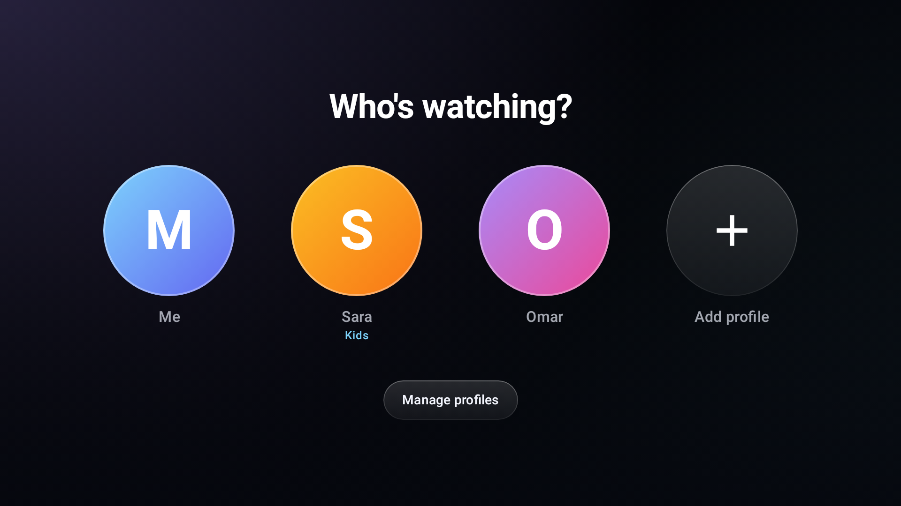 | 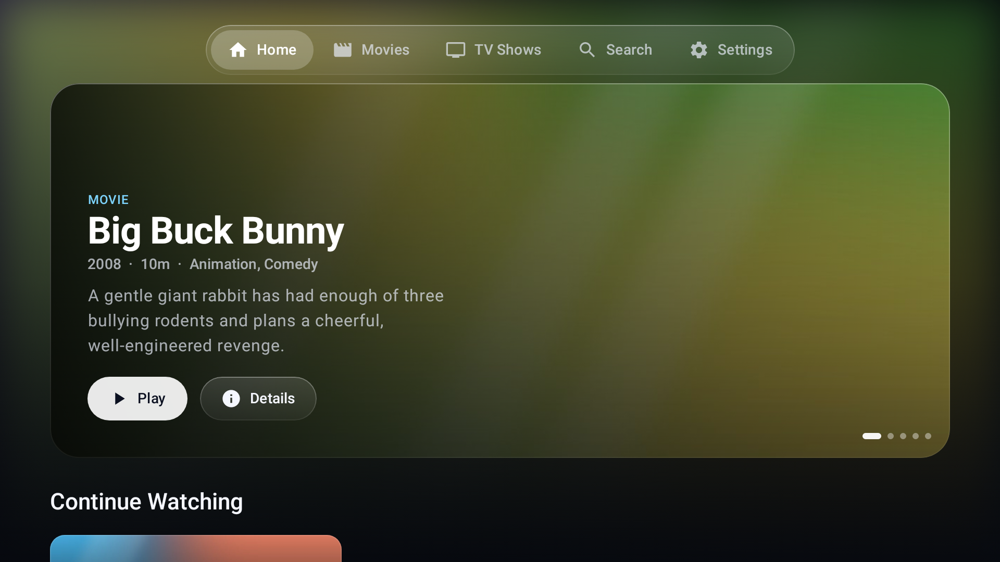 |
| **Movies** | |
| 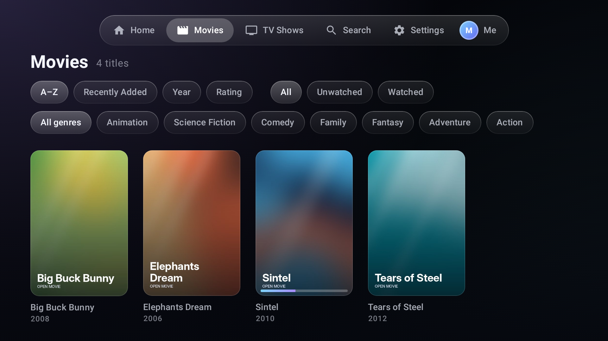 | |
| **Movie details** | **TV show with episodes** |
| 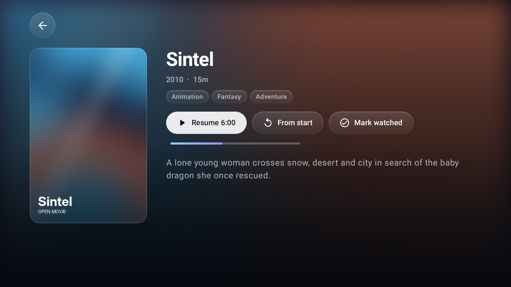 | 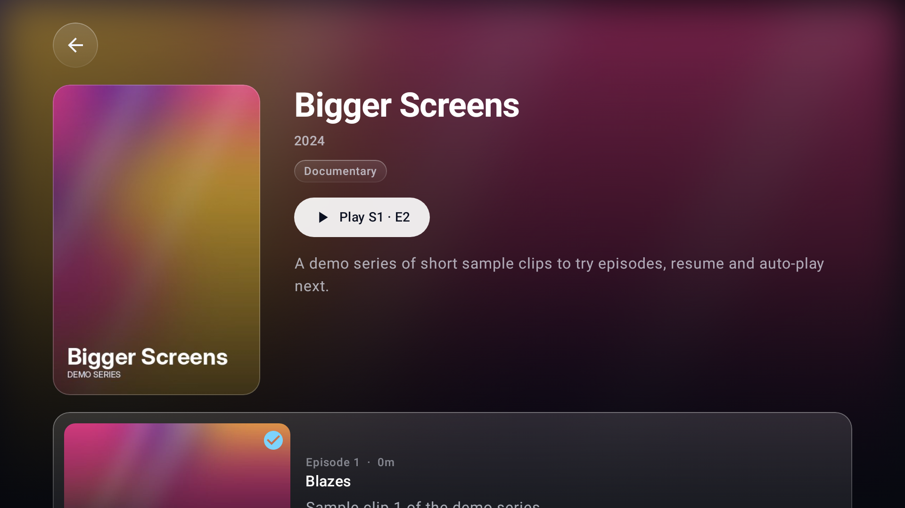 |
| **Player controls** | **Subtitle picker** |
| 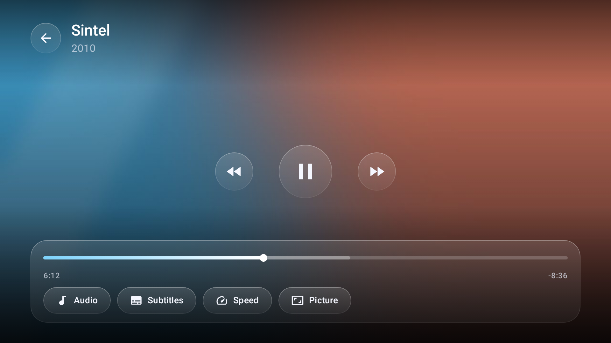 | 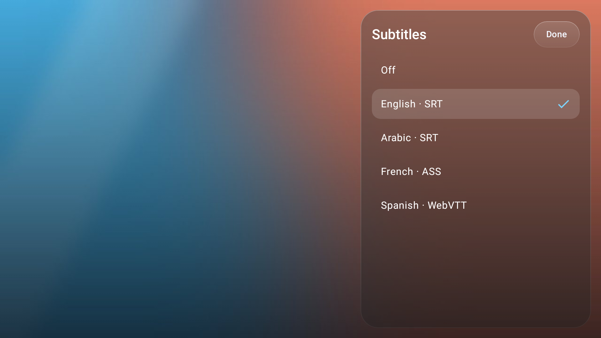 |
| **Settings** | |
| 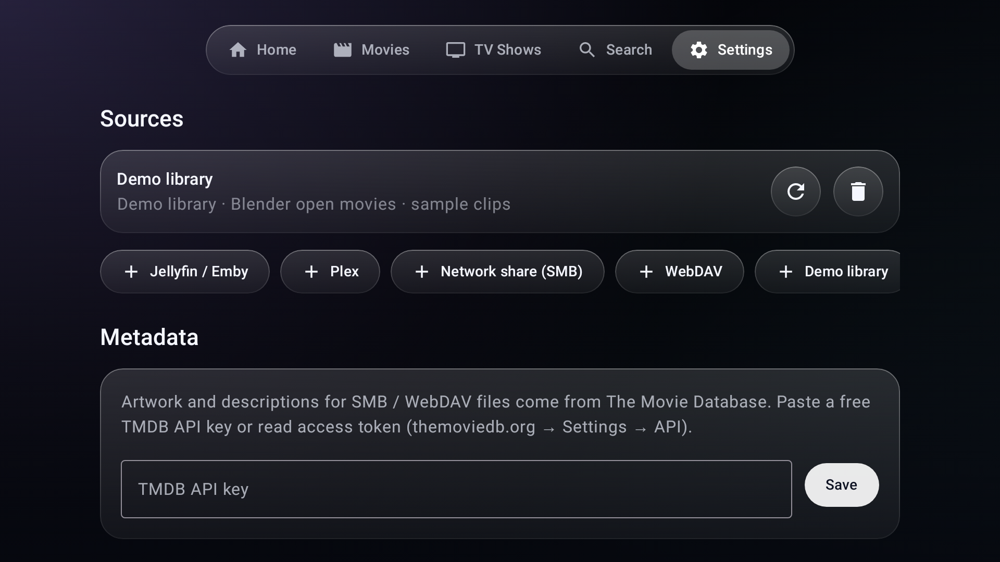 | |

**Phone**

| Home | Movies | Movie | Show |
|---|---|---|---|
| 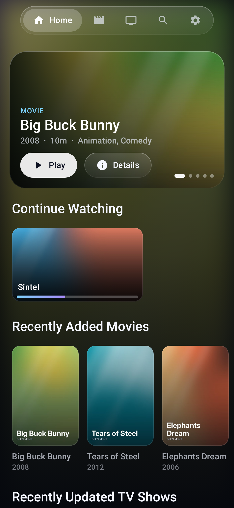 | 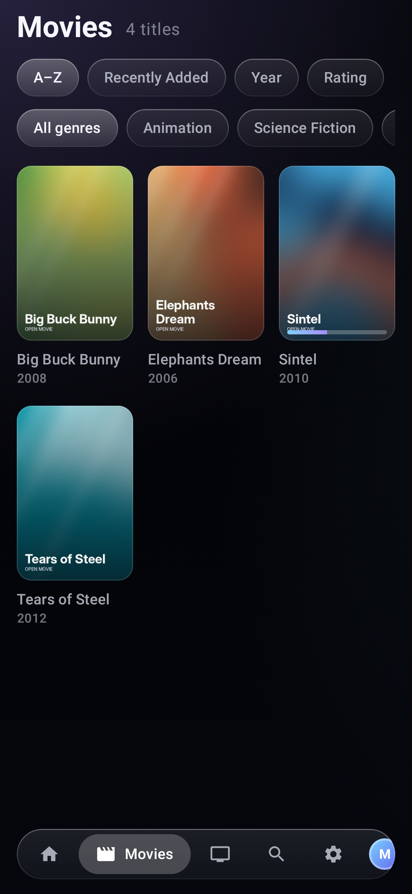 | 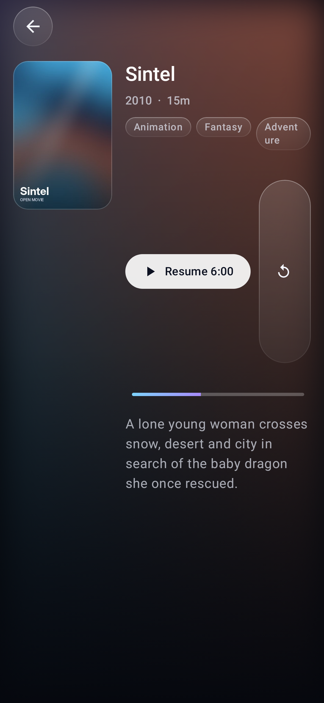 | 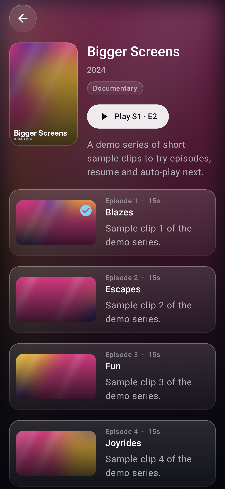 |

The player screenshots show the controls drawn over a still frame with a sample subtitle list, because unit tests can't decode video.

## Features

**Profiles**
- "Who's watching?" picker with up to 8 profiles, each with its own Continue Watching and watched history
- Kids profiles only show family-friendly titles (Family, Animation, Kids)
- Switch from the avatar at the end of the tab bar; manage in Settings → Profiles

**Library**
- Home screen with a rotating hero, plus Continue Watching, Recently Added, Movies, TV Shows, Top Rated and genre shelves
- Movies and TV Shows grids with sorting (A–Z, recently added, year, rating), genre filters and watched/unwatched filters
- Detail pages with artwork, ratings, genres and overview, plus season tabs and episode lists with progress bars
- Search across every source
- One merged library across all sources

**Sources**
| Source | Sign-in | Metadata | Sync back |
|---|---|---|---|
| Jellyfin / Emby | Username + password | From server | Resume points and watched state |
| Plex | Code at plex.tv/link, or URL + token | From server | Timeline and scrobble |
| SMB (Windows/macOS/NAS) | User/pass or guest, SMB 2/3 | TMDB, from file names | Local |
| WebDAV (Nextcloud, NAS, rclone) | Basic auth | TMDB, from file names | Local |

File names like `Movie.Name.2019.1080p.mkv` and `Show.S02E05.mkv` (or `Show/Season 2/…`)
are matched automatically. Sidecar subtitles (`.srt .vtt .ass .ssa`) next to the video are picked up.

**Player**
- Glass controls: play/pause, skip back/forward, scrubbing seek bar, time remaining
- Audio track picker (language, codec, channels) and subtitle picker (embedded and external)
- Playback speed and picture mode (fit, crop, stretch)
- Resume, auto-play next episode, and a Next Episode button
- D-pad remote support: left/right seeks, center shows the controls, plus media keys and a MediaSession
- Touch support: tap to show the controls, double-tap a side to skip
- Preferred audio and subtitle languages, subtitle size, skip intervals

## Install

Download the APK from the **[latest release](../../releases/latest)**. The same APK runs on both TV and phone.
Every push also builds APKs in GitHub Actions (**Actions → Android build → Artifacts**).

On first launch, choose **Try the demo** to browse a sample library of open-licensed Blender films
(Big Buck Bunny, Elephants Dream, Sintel, Tears of Steel) streamed from Google's public test bucket.

- **Phone:** open the APK and allow installing from unknown sources.
- **Android TV:** `adb connect <tv-ip> && adb install -r app-release.apk`, or sideload it with an app such as *Downloader* or *Send Files to TV*.
  Prism appears in the TV launcher row.

## Build locally

You need JDK 17 and the Android SDK (API 34).

```
./gradlew assembleDebug
```

## Tips
- For artwork on SMB/WebDAV sources, add a free TMDB API key in **Settings → Metadata**, then press refresh on the source.
- Some codecs (DTS, TrueHD, some HEVC profiles) depend on what the device can decode. If your device can't play a file directly, Jellyfin/Plex sources are the most reliable option.
- Passwords for SMB/WebDAV are stored in the app's private storage on the device.

## Releases and in-app updates

The app checks GitHub Releases when it starts, and when you press **Settings → Updates → Check for updates**.
When a newer version exists, it shows an update card. **Update now** downloads the APK and hands it to Android's installer.

To publish a version, run **Actions → Release → Run workflow** and enter a version such as `v0.2.1`.
The version number must be higher than the previous one.

Releases are signed with one permanent key, which Android requires before it will install an update over an existing app.
The key is stored in the repository secret `PRISM_KEYSTORE_BASE64`. You can also set `PRISM_KEYSTORE_PASSWORD` if the key uses a different password.
The release workflow refuses to run without the key, so a release can never be signed with the wrong key.
