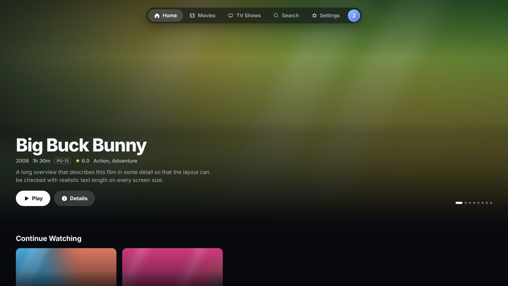
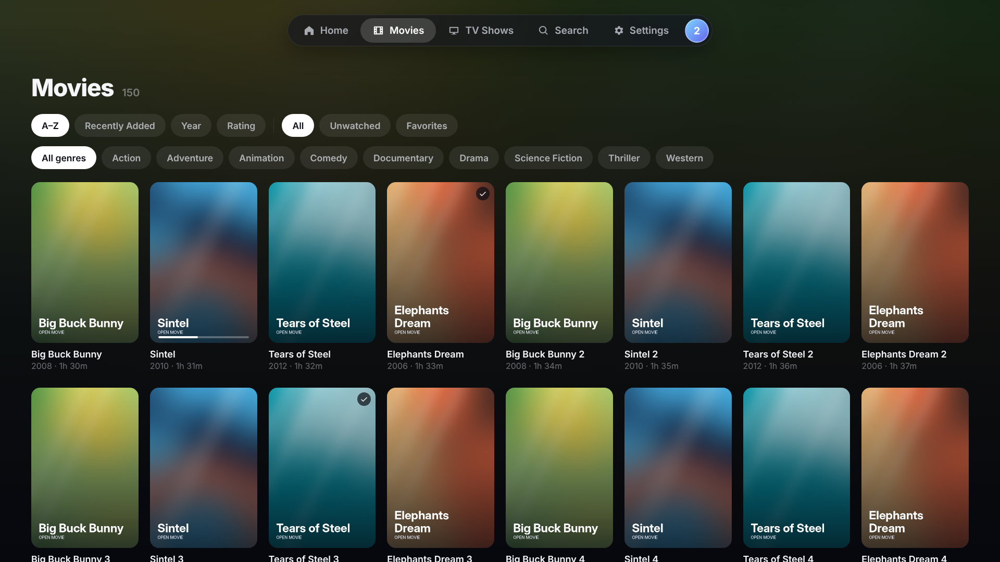
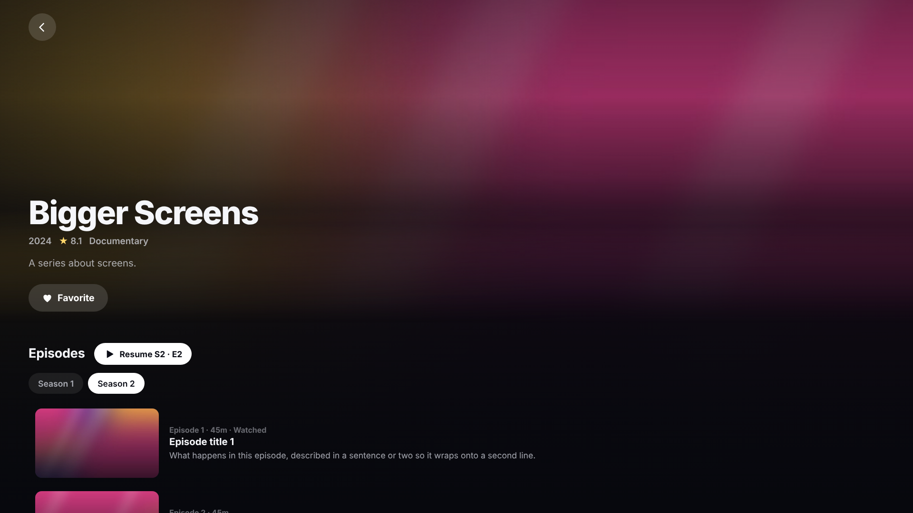
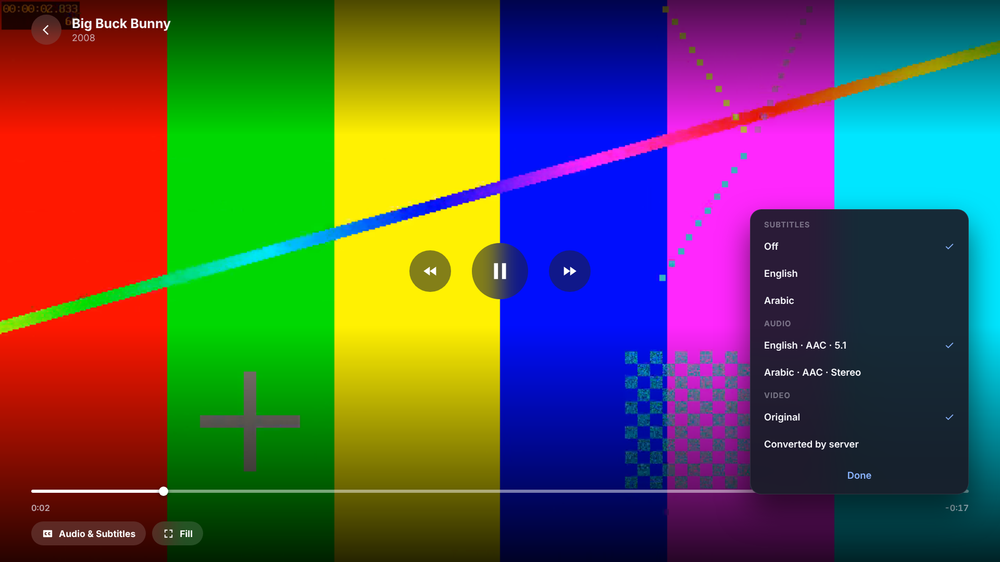
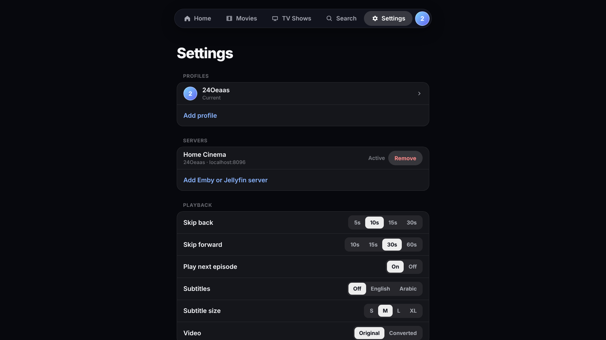
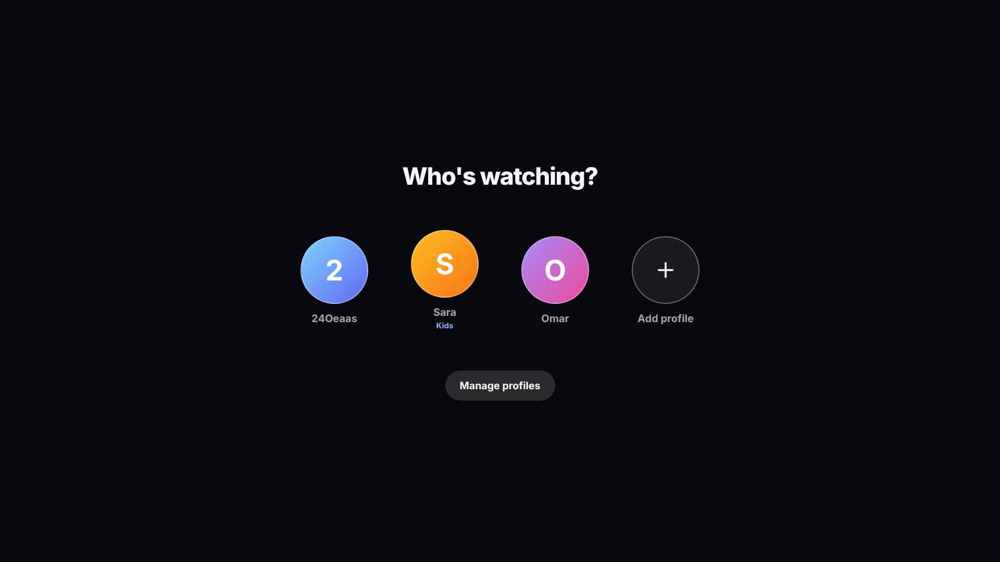
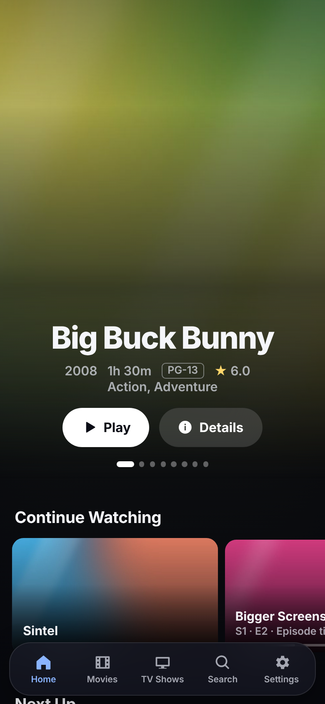
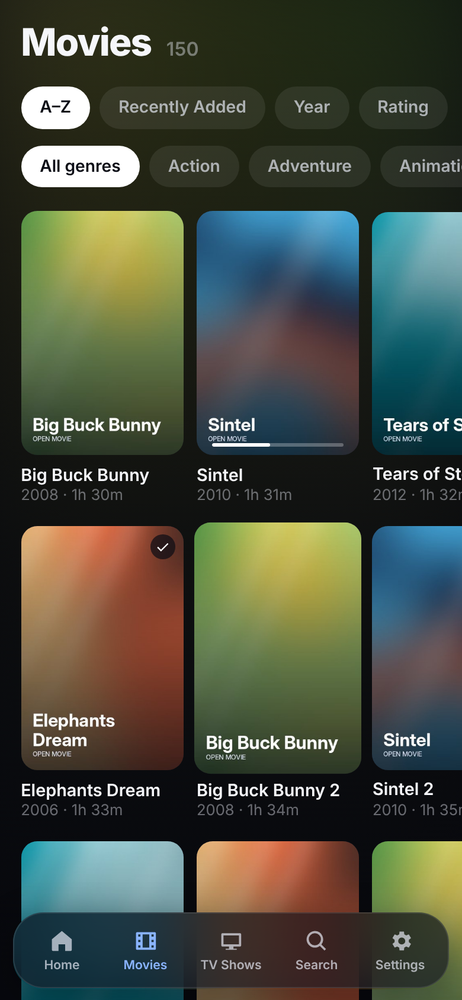
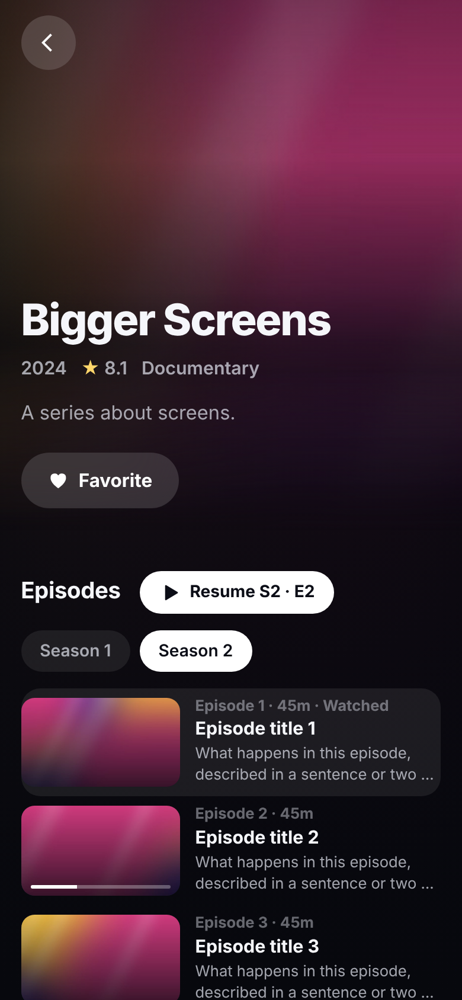
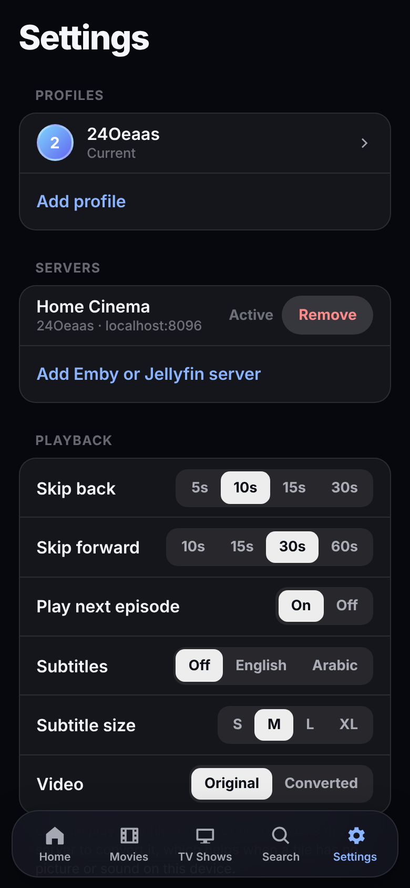

# Lumina

One media player for every screen: **web, Android phones and tablets, Android TV, Windows, Linux, LG TVs (webOS), Samsung TVs (Tizen), and iPhone/iPad** (as a home-screen web app).
It plays the movies and shows on your own **Emby** or **Jellyfin** server. The app is original work and isn't affiliated with any other player.

It lives in [`web/`](web/) as a single React + TypeScript codebase. The same code is packaged for each platform by
[`.github/workflows/lumina.yml`](.github/workflows/lumina.yml).

| Home (TV / desktop) | Movies |
|---|---|
|  |  |
| **TV show** | **Player** |
|  |  |
| **Settings** | **Who's watching?** |
|  |  |

| Phone: Home | Movies | Show | Settings |
|---|---|---|---|
|  |  |  |  |

## What it does

- **Sign in** with your server's username and password. The requests are the same ones the open-source
  [StreamBridge](https://github.com/h4harsimran/streambridge) project sends (`POST /Users/AuthenticateByName` with a
  `MediaBrowser` `X-Emby-Authorization` header and a JSON body, then `X-Emby-Token` on every call).
- **Home** with featured artwork, Continue Watching, Next Up, recently added, favorites and top rated.
- **Movies and TV Shows** grids that load page by page from the server, so very large libraries stay fast; sort, genre and watched filters.
- **Details** with seasons and episodes, cast, similar titles, favorites and watched state (synced to the server).
- **Player**: resume, skip, scrubbing, subtitles, audio tracks, next episode. Plays the original file, and can ask the server to convert it when the device can't play the format.
- **Profiles**: "Who's watching?", each profile with its own servers; kids profiles are limited to PG titles by the server.
- **TV remotes**: arrow keys move focus, OK selects, Back goes back, media keys control playback.

## Develop and test

```
cd web
npm install
npm run dev          # http://localhost:5173
npm run build        # output in web/dist
node test/shots.mjs  # end-to-end checks against a strict mock Emby server + screenshots
```

## Platform notes

| Platform | Package | Notes |
|---|---|---|
| Web, iPhone, iPad | `Lumina-web.zip` / GitHub Pages | On iPhone: open in Safari → Share → Add to Home Screen. An `https://` page can only reach `https://` servers. |
| Android, Android TV | `Lumina-android.apk` | A WebView app; playback uses the device's built-in video support. |
| Windows, Linux | `.exe` installer, `.AppImage` | Unsigned, so Windows shows a warning on first run. |
| LG webOS | `.ipk` | Needs Developer Mode on the TV. |
| Samsung Tizen | `.wgt` (unsigned) | Must be signed with your own Samsung certificate in Tizen Studio. |

Format support depends on the device: browsers and WebViews can't decode every MKV, HEVC, DTS or TrueHD file. When direct play fails,
Lumina asks the server for a converted stream, which only works if the server allows transcoding.

---

# Prism Player (original native Android app)

The first version of this project, a native Kotlin app in [`app/`](app/). It is still built and released (tags `v0.x`), and adds Plex, SMB and WebDAV sources.

## Screenshots

These are rendered automatically from the real app code at TV and phone sizes (see `app/src/test`), using the built-in demo library.
They're refreshed on every push.

**Android TV**

| Who's watching? | Home |
|---|---|
|  |  |
| **Movies** | |
|  | |
| **Movie details** | **TV show with episodes** |
|  |  |
| **Player controls** | **Subtitle picker** |
|  |  |
| **Settings** | |
|  | |

**Phone**

| Home | Movies | Movie | Show |
|---|---|---|---|
|  |  |  |  |

The player screenshots show the controls drawn over a still frame with a sample subtitle list, because unit tests can't decode video.

## Features

**Profiles**
- "Who's watching?" picker with up to 8 profiles, each with its own Continue Watching and watched history
- Kids profiles only show family-friendly titles (Family, Animation, Kids)
- Switch from the avatar at the end of the tab bar; manage in Settings → Profiles

**Library**
- Home screen with a rotating hero, plus Continue Watching, Recently Added, Movies, TV Shows, Top Rated and genre shelves
- Movies and TV Shows grids with sorting (A–Z, recently added, year, rating), genre filters and watched/unwatched filters
- Detail pages with artwork, ratings, genres and overview, plus season tabs and episode lists with progress bars
- Search across every source
- One merged library across all sources

**Sources**
| Source | Sign-in | Metadata | Sync back |
|---|---|---|---|
| Jellyfin / Emby | Username + password | From server | Resume points and watched state |
| Plex | Code at plex.tv/link, or URL + token | From server | Timeline and scrobble |
| SMB (Windows/macOS/NAS) | User/pass or guest, SMB 2/3 | TMDB, from file names | Local |
| WebDAV (Nextcloud, NAS, rclone) | Basic auth | TMDB, from file names | Local |

File names like `Movie.Name.2019.1080p.mkv` and `Show.S02E05.mkv` (or `Show/Season 2/…`)
are matched automatically. Sidecar subtitles (`.srt .vtt .ass .ssa`) next to the video are picked up.

**Player**
- Glass controls: play/pause, skip back/forward, scrubbing seek bar, time remaining
- Audio track picker (language, codec, channels) and subtitle picker (embedded and external)
- Playback speed and picture mode (fit, crop, stretch)
- Resume, auto-play next episode, and a Next Episode button
- D-pad remote support: left/right seeks, center shows the controls, plus media keys and a MediaSession
- Touch support: tap to show the controls, double-tap a side to skip
- Preferred audio and subtitle languages, subtitle size, skip intervals

## Install

Download the APK from the **[latest release](../../releases/latest)**. The same APK runs on both TV and phone.
Every push also builds APKs in GitHub Actions (**Actions → Android build → Artifacts**).

On first launch, choose **Try the demo** to browse a sample library of open-licensed Blender films
(Big Buck Bunny, Elephants Dream, Sintel, Tears of Steel) streamed from Google's public test bucket.

- **Phone:** open the APK and allow installing from unknown sources.
- **Android TV:** `adb connect <tv-ip> && adb install -r app-release.apk`, or sideload it with an app such as *Downloader* or *Send Files to TV*.
  Prism appears in the TV launcher row.

## Build locally

You need JDK 17 and the Android SDK (API 34).

```
./gradlew assembleDebug
```

## Tips
- For artwork on SMB/WebDAV sources, add a free TMDB API key in **Settings → Metadata**, then press refresh on the source.
- Some codecs (DTS, TrueHD, some HEVC profiles) depend on what the device can decode. If your device can't play a file directly, Jellyfin/Plex sources are the most reliable option.
- Passwords for SMB/WebDAV are stored in the app's private storage on the device.

## Releases and in-app updates

The app checks GitHub Releases when it starts, and when you press **Settings → Updates → Check for updates**.
When a newer version exists, it shows an update card. **Update now** downloads the APK and hands it to Android's installer.

To publish a version, run **Actions → Release → Run workflow** and enter a version such as `v0.2.1`.
The version number must be higher than the previous one.

Releases are signed with one permanent key, which Android requires before it will install an update over an existing app.
The key is stored in the repository secret `PRISM_KEYSTORE_BASE64`. You can also set `PRISM_KEYSTORE_PASSWORD` if the key uses a different password.
The release workflow refuses to run without the key, so a release can never be signed with the wrong key.
